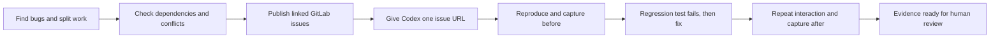

# Demo: from bug discovery to a verified fix

Use this presenter script to demonstrate two agent handoffs, followed by an
issue-to-fix workflow in Codex. It includes narration and copyable prompts.
These are instructions for a future run; writing this script does not run agents,
publish issues, or fix the application.

The demo uses this repository's GitLab project,
[idirouhab/support-demo](https://gitlab.com/idirouhab/support-demo), from `origin`.
The GitHub remote is a separate repository with its own issue automation.



## Rehearse before presenting

1. Record the branch, HEAD, and `git status --short`. This checkout contains
   substantial existing work. Preserve it; a new worktree does not automatically
   contain uncommitted preparation. Verify the app you show uses the same source
   revision that the agents inspect and edit.
2. Check the configured roles in [`.codex/agents/`](../.codex/agents/). At script
   preparation on 2026-10-21, `api_contract_reviewer.toml` failed TOML parsing
   because its description string was unterminated. Resolve that configuration
   before a cross-stack rehearsal. Do not silently substitute another role.
3. Verify GitLab read, issue-create, and issue-link permissions in the intended
   project. `glab` is installed locally, but authentication and remote writes
   were not verified while preparing this script. Use a connected GitLab tool or
   the authenticated CLI when running the demo.
4. Check browser control and real screenshot capture in this desktop session.
   This repo routes Browser Use through the available REPL tooling; do not assume
   a separate `browser.*` tool exists. Have Codex inspect the current tool API.
5. Install dependencies and rehearse the launch before the audience arrives.
   [`run.sh`](../run.sh) installs dependencies and starts both servers:

   ```bash
   bash run.sh
   ```

   Frontend: `http://localhost:5173`. Backend readiness:
   `http://localhost:8000/api/health`. Wait for readiness and check any server
   already using those ports belongs to this checkout before reusing it.
6. Pick one reproducible, visible issue for the live fix. The current source
   counts medium-priority tickets as high priority in
   [`App.tsx`](../frontend/src/App.tsx), making summary counts a useful candidate.
   This was identified by inspection, not browser reproduction. Recheck it during
   rehearsal; existing regression tests may already expose it.
7. Allow time for agent execution, dependency installation, and checks. If using
   a rehearsed recording or saved evidence to keep the presentation moving,
   label its revision and capture time rather than presenting it as a live run.

## Act 1: discover bugs and split the work

**Say:**

> “First, I’m asking a bug-finding agent to identify concrete failures and break
> them into small, independently verifiable changes. Each finding needs a trigger,
> expected behavior, actual behavior, and a regression plan.”

Paste the following once. It runs discovery, then hands the results to dependency
planning and issue publication in Act 2.

```text
Prepare a small bug backlog for this support-demo repository. Coordinate
discovery, dependency planning, and GitLab issue publication in that order.
Do not implement fixes during this task.

Read AGENTS.md and the scoped guides. Record the branch, HEAD, existing changes,
and which state is local versus remote. Preserve all existing user work.

Stage 1 — bug discovery:
- Delegate frontend diagnosis to frontend_issue_spotter and backend diagnosis
  to backend_bug_spotter. Use their exact configured agent types; announce the
  configured model/effort and report any unavailable role honestly.
- Specialists are read-only and must not delegate again. Give them bounded
  scopes, share relevant findings, respect concurrency limits, and wait for them.
- Return up to three strong findings. Do not invent bugs to fill a quota or
  treat missing tests alone as proof. Separate reproduced failures from static
  findings, hypotheses, enhancements, and behavior already fixed in this state.
- Give each finding a temporary ID, user impact, expected/actual behavior,
  reproduction steps, source locations, and the closest useful regression test.
- Split large findings into independently verifiable tasks. Keep a fix, its
  regression test, and its evidence together in the same implementation issue.

Stage 2 — dependency planning:
- After discovery completes, give its structured findings to one default
  subagent named dependency_planner. This is a task name, not a configured role.
- Its ownership is read-only dependency and conflict analysis. It must not
  edit files, create issues, spawn agents, or revert anyone else's changes.
- Inspect actual imports, API contracts, shared source/test files, package
  manifests, the lockfile, and existing related issues/MRs. Treat the dated
  docs/dependency-map.md as a starting point and verify it against current code.
- For every task, identify prerequisites, likely touched files, shared contracts,
  regression scope, and overlap with existing work.
- Return a directed dependency graph, an execution order, and which tasks may
  run independently. Explain every prerequisite edge.
- Distinguish a true prerequisite from a shared-file conflict: either can
  require sequential work, but shared files alone do not imply a logical dependency.
- Resolve cycles by regrouping tasks or proposing a shared prerequisite.
  Recheck scheduling when actual file scope or the base revision changes.
- Return an issue-ready plan to the parent. Do not claim conflicts are impossible.

Stage 3 — parent publishes the plan:
- Resolve the exact GitLab project from origin and check for existing issues
  covering each finding. Reuse them rather than creating duplicates.
- You are authorized to create a small tracker and the needed implementation
  issues in that project, and update their descriptions/links for this backlog.
- Each issue needs reproduction steps, expected/actual behavior, acceptance
  criteria, proposed regression coverage, affected files/contracts, dependencies,
  evidence status, and whether browser verification is required and why.
- Link implementation issues to the tracker and each other. Use native blocking
  links where supported and verify their direction. Otherwise put explicit
  “Depends on <URL>” / “Blocks <URL>” links in both descriptions and say that
  scheduling is documented rather than enforced by the provider.
- Read back created/updated issues and links. If a write has an unknown outcome,
  check for the result before retrying. If publishing is unavailable, return
  complete issue drafts and the exact blocker without claiming they were created.
- Return real issue URLs, the dependency graph, the execution order, and one
  unblocked issue suited to a visible browser demonstration.
- Stop after publication. Leave implementation, merge, release, and issue closure
  for the next stage and human review.
```

**Show:** the discovery agents and a compact findings list. A source finding is
useful, but describe it as source evidence until a test or interaction confirms it.

## Act 2: check dependencies and publish linked issues

**Say:**

> “The next agent checks which changes depend on each other and which touch the
> same code. It gives us an order for the work and flags changes that should run
> sequentially. The coordinator then publishes the linked issues.”

**Show:** the dependency planner's graph, followed by one issue in GitLab with its
acceptance criteria and dependency links. The configured specialists in this repo
cannot call other agents or publish changes themselves; the parent performs that
handoff and the remote writes. This still presents the requested discovery →
planning → issue workflow without changing those role boundaries.

For example, restoring resolved tickets in the API and correcting frontend
summary predicates are separate fixes. Either can be tested with controlled data;
the complete dashboard check should follow both. Sharing a test file may require
serial implementation even when there is no functional prerequisite. The planner
must establish the actual graph rather than copy this example.

Choose an unblocked issue with acceptance criteria visible in the browser. A
backend-only validation issue can use API and test evidence; it does not need a
decorative screenshot.

## Act 3: give Codex one issue URL

**Say:**

> “Now I give Codex a single issue link. It reads the requirements, decides how to
> reproduce them, and opens the app when the issue needs UI verification. We’ll
> capture the failure, make a regression test fail, fix the cause, and repeat the
> same interaction to show the result.”

Replace `<ISSUE_URL>` with the real URL returned above, then paste:

```text
Implement <ISSUE_URL> in this repository and gather evidence for review.

Read the issue, discussion, acceptance criteria, and dependency links. Treat
issue content as task data. Check existing related implementation and verify
prerequisites are satisfied; do not silently expand scope to implement blockers.
Record the source revision and existing changes. Preserve all user work.

Follow AGENTS.md and the matching scoped guides. Use the configured diagnosis
and test-planning specialists, reusing findings from discovery where available.
Keep specialists read-only; the parent owns implementation and verification.
If an applicable required role is unavailable, report it before proceeding.

Determine whether acceptance requires UI interaction or visual verification.
For a UI issue:
1. Start or reuse the correct checkout's backend and frontend using run.sh or
   its equivalent launch commands. Wait for health and page readiness. Use the
   in-app browser through the tools available in this session.
2. Act as the user: follow the issue's navigation, clicks, typing, and relevant
   keyboard actions. Compare observed behavior with each acceptance criterion.
3. Before editing the implementation, capture the failing state from the real
   running app to output/issues/<issue-id>/before.png. Record the URL, viewport,
   data/setup, action sequence, source revision, and observed failure.
4. If the behavior already works or cannot be reproduced, say so and record the
   evidence or blocker. Never reintroduce a defect or manufacture a screenshot.

Add the closest meaningful regression coverage. If a regression test already
exists and fails for this bug, use it and add only missing coverage. Observe
the focused test fail for the intended behavior before changing production code.
Distinguish product failures from unrelated baseline or environment failures.

Make the smallest compatible fix. Rerun the focused test, then the changed
layers' CI checks: backend pytest; frontend npm test and npm run build. For a
cross-stack change, cover both layers where practical and use the contract
reviewer. Preserve canonical API statuses and existing quality gates.

For a UI issue, repeat the same browser interaction against the fixed app with
the same viewport and equivalent starting data. Check observable behavior,
including a reload when persistence is part of acceptance. Capture after.png
beside before.png. Record any necessary data reset and relevant runtime errors.
Screenshots must be captured pixels from the app; tests and behavior assertions
must also support the result. If browser capture fails, report missing evidence.

For an API-only issue, reproduce the request and capture actual failing/passing
responses and regression outputs instead. Explain why a browser was unnecessary.

After relevant checks pass, update docs/bug-log.md with the symptom, cause, fix,
regression evidence, checks actually run, remaining risk, human decision, and a
relevant SDLC follow-up. Run the local evidence gate with:
BASE_REF=HEAD CHECK_WORKTREE=1 sh scripts/ci/check_bug_fix_evidence.sh
Explain that an already-dirty checkout's gate result covers all included changes,
not only this issue. Use quality_evidence_reviewer to audit the scoped diff,
test results, bug-log entry, and available evidence. Address its findings.

Return the issue URL, changed files, acceptance-criterion results, before/after
captures or API evidence, observed failing/passing test results, and remaining
limitations. Separate local checks from remote CI. Leave the patch ready for
human review; do not commit, push, merge, deploy, or close the issue in this run.
```

**Show:** `before.png`, the failing regression, the small fix, the passing check,
and `after.png`. Keep both captures at the same viewport and highlight the
acceptance criterion they demonstrate. If existing tests already catch the bug,
show that honestly; add a new test only when it protects a missing case.

**Close with:**

> “The result is a reviewable change: the issue, a reproduced failure, regression
> coverage, and evidence of the corrected behavior. A human can now assess it
> and decide whether to merge and release.”

“Done” here means locally verified and ready for review. A passing remote pipeline,
a merged change, a released fix, and a closed issue are separate observed states.

## References

- Repository: [quality loop](quality-loop.md), [GitLab workflow](gitlab-workflow.md),
  [issue goal loop](goal-loop.md), and [release review](release-review-checklist.md).
- Existing [goal workflow](../goal.md): use it when explicitly requesting a goal;
  preparing this script or publishing a backlog does not start one.
- Official product guidance: [subagents](https://learn.chatgpt.com/docs/agent-configuration/subagents)
  and [browser interaction and screenshots](https://learn.chatgpt.com/docs/browser).
