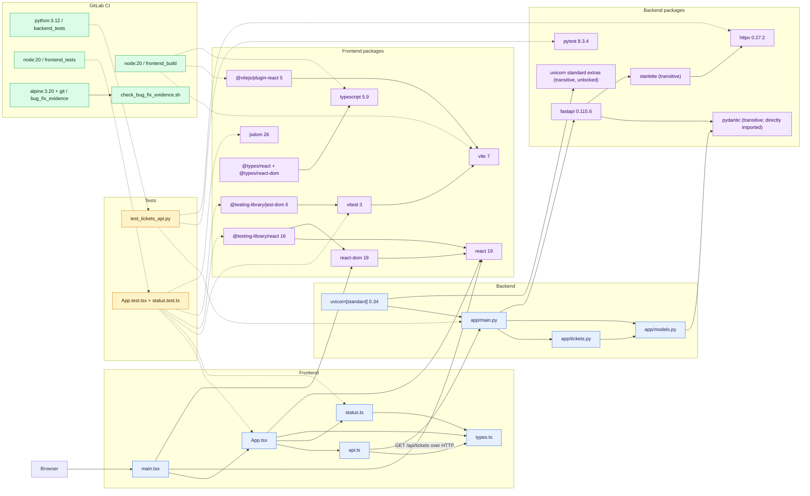

# Project Dependency Map

This map shows the repository's application, package, test, build, and CI dependencies. It is based on the source imports, `backend/requirements.txt`, `frontend/package.json`, `frontend/package-lock.json`, and `.gitlab-ci.yml` as of 2026-08-10.

Solid arrows represent runtime or source-import dependencies. Dotted arrows represent test, build, or CI dependencies. The HTTP arrow is the frontend/backend contract; its base URL defaults to `http://localhost:8000` and can be overridden with `VITE_API_BASE_URL`.

## Direct Dependency Inventory

| Area | Purpose | Direct dependencies |
| --- | --- | --- |
| Frontend runtime | Browser UI | `react`, `react-dom` |
| Frontend build | Bundling, JSX transform, type checking | `vite`, `@vitejs/plugin-react`, `typescript` |
| Frontend test | Test runner, DOM environment, rendering assertions, types | `vitest`, `jsdom`, `@testing-library/react`, `@testing-library/jest-dom`, `@types/react`, `@types/react-dom` |
| Backend runtime | API, ASGI server | `fastapi`, `uvicorn[standard]` |
| Backend test | Test runner and HTTP client support | `pytest`, `httpx` |
| CI images/tools | Pipeline execution | `python:3.12`, `node:20`, `alpine:3.20`, `git` |

## Dependency Notes

- `pydantic` is imported directly by `backend/app/models.py`, but it is only installed transitively through FastAPI. Declaring it directly would make that source-level dependency explicit.
- `vite`, `@vitejs/plugin-react`, and `typescript` are build-time tools, although they currently live under `dependencies` rather than `devDependencies` in `frontend/package.json`.
- The frontend lockfile contains 209 resolved packages beyond the root project. The diagram intentionally collapses those transitive implementation details into their direct parents.
- Backend dependencies are version-pinned at the top level, but there is no backend lockfile, so transitive versions can change on a fresh install.
- Browser-native `fetch` and `Intl.DateTimeFormat` are platform APIs, not installed packages.

## Sources of Truth

- Backend packages: `backend/requirements.txt`
- Backend pytest configuration: `backend/pyproject.toml`
- Frontend direct packages and scripts: `frontend/package.json`
- Frontend resolved dependency tree: `frontend/package-lock.json`
- Pipeline dependencies: `.gitlab-ci.yml`
