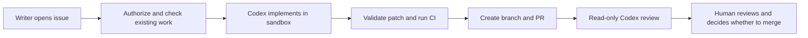

# GitHub issue → implementation → PR → review

Repository: [idirouhab/support-demo](https://github.com/idirouhab/support-demo).
GitHub is an additional automation and review surface. The `origin` GitLab remote,
`.gitlab-ci.yml`, GitLab merge-request template, and `bug_fix_evidence` gate remain
unchanged. GitHub pushes do not automatically update GitLab.

## Using the automation

Open an issue with a concrete problem, reproduction steps, expected behavior, and
acceptance criteria. No label or special mention is required when the person
opening it has write, maintain, or admin access to this repository.



1. **Codex issue implementation** runs on `issues: opened`. It reads the issue as
   data, honors `AGENTS.md`, adds regression coverage for bug fixes, and asks Codex
   to update `docs/bug-log.md` after checks pass.
2. A fresh runner validates the proposed patch and runs backend tests, frontend
   tests, the production build, automation-helper tests, and the existing bug-fix
   evidence gate. A failing check prevents PR publication; it is not bypassed.
3. A separate publishing job creates `codex/issue-<number>`, opens a PR linked to
   the issue, and comments on the issue with the PR and workflow evidence links.
4. The publishing workflow directly calls **Codex PR review**. Codex reviews the
   exact base/head diff in a read-only sandbox. Feedback is an advisory PR comment,
   updated on later reviews only if the reviewed base and head are still current.
5. A human reviews tests, findings, and remaining risks. The workflows never
   approve, merge, close an issue directly, or deploy. Merging a PR with `Closes #N`
   lets GitHub close the linked issue normally.

Ordinary same-repository PRs also run **CI** and **Codex PR review** on `opened`,
`synchronize`, and `reopened`. Fork PRs receive secret-free CI, but not Codex review.

## Why the direct review call matters

The workflow uses GitHub's short-lived `GITHUB_TOKEN`, not a stored personal access
token. Events caused by this token do not behave like a user's events: current
GitHub documentation describes bot-created PR workflows as approval-required,
while `push` workflows are suppressed. A reusable `workflow_call` runs the review
directly, so the issue flow does not depend on manually approving a second run.
The same reusable CI workflow validates the patch before publication.

If GitHub shows an **Approve workflows to run** banner on a bot-created PR, the
linked issue workflow already contains its validation and review. You can approve
the separate PR-event runs if you need their checks associated with that PR.
Before making PR checks mandatory through branch protection, decide whether to
use those approvals or a narrowly scoped GitHub App token for native PR events.
Do not silently replace `GITHUB_TOKEN` with a broad personal token.

See [GitHub's workflow-trigger rules](https://docs.github.com/en/actions/how-tos/write-workflows/choose-when-workflows-run/trigger-a-workflow)
and [reusable workflows](https://docs.github.com/en/actions/how-tos/reuse-automations/reuse-workflows).

## Repository setup

These files must be on the default branch (`main`) before issue events and manual
workflow dispatches are available:

| File | Purpose |
| --- | --- |
| `.github/workflows/codex-issue.yml` | Authorize issue work, implement, validate, publish, and call review |
| `.github/workflows/codex-review.yml` | Same-repository PR events, reusable review, and manual review |
| `.github/workflows/checks.yml` | Tests, build, automation tests, and existing evidence gate |
| `.github/codex/issue.md` | Implementation task and quality/security constraints |
| `scripts/github/` | Tested API orchestration and patch validation |

Required repository settings:

- Actions enabled; allow the referenced GitHub and OpenAI actions.
- Repository Actions secret **`OPENAI_API_KEY`** containing the OpenAI API key.
- Actions → General → Workflow permissions → **Allow GitHub Actions to create and
  approve pull requests** enabled. GitHub groups creation and approval in this
  setting; these workflows only create PRs and never approve them. Default token
  permissions can and should remain read-only; each job requests its own scope.
- Issues enabled.

The local `.env` is ignored by Git and does not exist on GitHub runners. Only the
`OPENAI_API_KEY` value belongs in the encrypted repository secret, never the whole
file. To replace it later, use the CLI's interactive secret prompt:

```bash
gh secret set OPENAI_API_KEY --repo idirouhab/support-demo
```

Authentication uses the OpenAI API key, not a ChatGPT subscription. Implementations
and reviews consume API usage and GitHub runner time. Configure an appropriate
OpenAI project budget/alerts and check usage. The optional repository variable
`CODEX_MODEL` selects an account-accessible model; if unset, the action uses its
default. Jobs have timeouts and use medium reasoning effort, not a dollar-spend cap.
See the [official Codex Action documentation](https://learn.chatgpt.com/docs/github-action).

## Retries and manual operation

For an existing open issue, or a failed run before branch publication:

```bash
gh workflow run codex-issue.yml --repo idirouhab/support-demo --ref main -f issue_number=123
```

Only repository writers can request work. Both the original actor and the rerun
actor are checked. Public issues from other users are skipped automatically;
a writer can explicitly dispatch a selected public issue after reviewing it.
Bot actors are excluded from implementation to prevent recursive issue work.

Existing open PRs on the issue branch are left untouched. If a branch exists but
has no open PR, automation stops rather than overwriting it. Inspect the branch:
open its PR manually, or delete it yourself if it is obsolete before retrying.
Concurrent runs for the same issue are serialized. A closed issue produces no new
implementation. Closing an issue does not cancel an already-running model job;
cancel that job explicitly if needed.

To rerun a review without regenerating the implementation:

```bash
gh workflow run codex-review.yml --repo idirouhab/support-demo --ref main -f pr_number=456
```

Inspect workflow runs and logs in the repository's Actions tab or with:

```bash
gh run list --repo idirouhab/support-demo
gh run view RUN_ID --repo idirouhab/support-demo --log-failed
```

Failures and no-patch outcomes leave an issue comment with the workflow link.
Implementation summaries are retained as artifacts for seven days; generated
patches for one day. An existing failing application test also blocks new work,
unless that issue fixes the failure. Keep that failure visible instead of weakening
the checks.

## Trust boundaries and limitations

- Only the Codex action receives the OpenAI secret, through its protected API
  proxy. It uses `drop-sudo`, `workspace-write` for implementation, and `read-only`
  for review. Credentials are not persisted by checkout.
- The implementation runner has no repository write token. The publisher has no
  OpenAI key and never executes generated application code, dependency installs,
  or tests. Patch validation is repeated on its fresh checkout before applying it.
- Generated patches may change ordinary files in `backend/`, `frontend/`, `docs/`,
  and `README.md`. Automation scripts, workflows, any `AGENTS.md`, hidden control
  files, `.env`/credential files, symlinks, and submodules are rejected. Patches are
  limited to 2 MiB and 100 changed files. Infrastructure/policy issues need a
  human-authored PR.
- Issue text and model output never become shell code. Hidden HTML comments are
  removed from issue bodies, but text filtering is not a complete prompt-injection
  defense; permissions and independent patch validation enforce the boundary.
- Existing work is never force-pushed. Generated output is still untrusted code:
  passing CI and a Codex review do not establish correctness or release readiness.
- Dependency installation runs before the model, on the trusted base revision.
  The sandbox is not opened for network-based dependency changes during generation.
- Reviews are static and advisory. They neither run tests nor turn findings into
  a blocking status; humans must read the comment and CI evidence.

## Local verification and SDLC follow-up

Use Python 3.12 and a current Node 22 release (compatible with the frontend's Vite
requirements). Existing GitLab jobs remain Python 3.12 / Node 20.

```bash
python3 -m unittest discover -s scripts/github/tests -v
node --test scripts/github/automation.test.cjs
```

Run `python -m pytest` from `backend`, and `npm test` / `npm run build` from
`frontend`. For the existing gate, stage new files before previewing so new tests
are included in the worktree comparison:

```bash
BASE_REF=HEAD CHECK_WORKTREE=1 sh scripts/ci/check_bug_fix_evidence.sh
```

Human follow-ups: decide branch-protection/required-check policy, review ownership
of `.github/` and `scripts/github/`, pin third-party actions to reviewed commit SHAs,
set API budgets, and decide how reviewed GitHub changes should reach GitLab.
